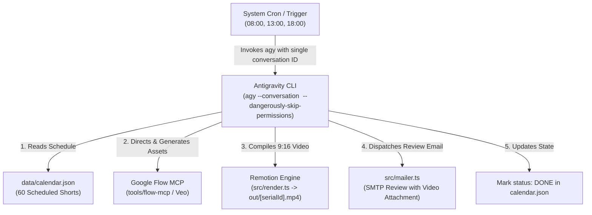

# Autonomous YouTube Shorts Production Engine (`yt-automation-wf`)

## 1. Mission & Operational Architecture
This project runs an autonomous production engine powered by **Antigravity CLI (`agy`)**. It scheduled, generates, edits, reviews, and dispatches high-retention 9:16 vertical YouTube Shorts (15–30 seconds) based on a structured content calendar (`data/calendar.json`).

All autonomous executions reuse a single persistent conversation context (`--conversation fcdb013c-7946-4c00-8518-a92ebcf45cdd`) so the agent preserves complete memory, feedback, and execution history.



---

## 2. Five-Stage Production Pipeline

### Stage 1: Queue Inspection
- Read `data/calendar.json`.
- Identify the eligible short matching the current slot (`08:00` Morning, `13:00` Afternoon, or `18:00` Evening) whose status is `PENDING`.
- Extract the 3 sequential clips:
  1. **The Hook** (~8–10s): Immediate premise and disruption (`visualAction`, `spokenLine`, `sfxCue`).
  2. **The Escalation** (~8–10s): Tension, mechanics, and macro shot.
  3. **The Climax** (~8–10s): Release, dramatic result, and loop teaser.

### Stage 2: Generative Visual Asset Production (Google Flow MCP)
- Google Flow MCP is installed at `tools/flow-mcp` and wired globally into `agy mcp`.
- Generates 9:16 vertical visual scenes for the 3 clips using Flow's free daily credits.
- One-time sign-in required on the host machine:
  ```bash
  cd tools/flow-mcp && npm run login
  ```

### Stage 3: Video Assembly & Kinetic Typography (Remotion)
- Remotion composition located at `src/remotion/ShortComposition.tsx` (1080x1920, 30fps).
- Features:
  - Sequences the 3 clips with dynamic transitions.
  - Kinetic typography styling the narration lines (`spokenLine`).
  - SFX cue badges and sound placement (`sfxCue`).
  - Top header and global progress bar.
- Render handler: `src/render.ts` (`renderShortVideo(entry)`).

### Stage 4: SMTP Notification & Review
- Uses `src/mailer.ts` (`sendReviewEmail({ serialId, title, videoPath })`).
- Emails the completed video to `NOTIFICATION_EMAIL` configured in `.env`.

### Stage 5: State Persistence
- Upon verified compilation and dispatch, mark the entry in `data/calendar.json` with `status: "DONE"`.

---

## 3. Autonomous Antigravity CLI Execution

### Headless Production Command
To produce the scheduled short using the persistent conversation:
```bash
agy --conversation fcdb013c-7946-4c00-8518-a92ebcf45cdd \
  -p "Produce the scheduled YouTube Short for the current time slot. Generate clip assets via Google Flow, assemble in Remotion to out/, dispatch the review email, and mark as DONE." \
  --dangerously-skip-permissions
```

### Scheduled Cron Automation (08:00, 13:00, 18:00)
Add to crontab (`crontab -e`):
```bash
0 8,13,18 * * * cd /home/oluomachi-c-udezue/projects/yt-automation-wf && /home/oluomachi-c-udezue/.local/bin/agy --conversation fcdb013c-7946-4c00-8518-a92ebcf45cdd -p "Execute scheduled YouTube Short production for current time slot." --dangerously-skip-permissions >> /home/oluomachi-c-udezue/projects/yt-automation-wf/cron.log 2>&1
```

---

## 4. Quality Gates & Validation
- **Typecheck:** `npm run typecheck` (`tsc --noEmit`)
- **Unit Tests:** `npm test` (`vitest run`)
- **Calendar Update:** `npm run update-calendar`
