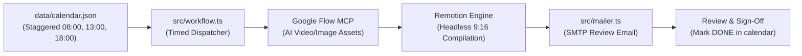

# YouTube Shorts Automated Production Engine (`yt-automation-wf`)

## 1. Project Overview & Mission
This project automates the end-to-end production, review, and scheduling of high-retention 9:16 vertical YouTube Shorts (15–30 seconds) based on a structured content calendar (`data/calendar.json`).

Each short follows a scientific hypothetical / "what if" format structured into 3 progressive clips:
1. **The Hook** (~8–10s): Immediate impossible premise, visual disruption.
2. **The Escalation** (~8–10s): Technical or macro breakdown, tension buildup.
3. **The Climax / Payoff** (~8–10s): Dramatic conclusion, loop teaser.

---

## 2. System Architecture & Workflow Pipeline



### Key Workflow Stages
1. **Queue Dispatcher (`src/workflow.ts`)**:
   - Compares the system clock with `scheduledDate` and `scheduledTime` (Morning `08:00`, Afternoon `13:00`, Evening `18:00`).
   - Identifies the next eligible `PENDING` short.
   - CLI flags: `--force` (run next pending immediately) and `--dry-run` (simulate without live SMTP).
2. **Asset Generation (Google Flow MCP)**:
   - Uses prompt cues (`visualAction`, `spokenLine`, `sfxCue`) to generate visual assets for the 3 clips.
3. **Video Compilation (Remotion)**:
   - Assembles clips into vertical 1080x1920 30fps `.mp4` videos with animated subtitles, progress bars, and SFX cues in `out/`.
4. **Review & Notification (`src/mailer.ts`)**:
   - Dispatches an HTML review email to the designated reviewer with video attachment.
5. **State Persistence**:
   - Updates `calendar.json` status to `DONE` upon successful execution.

---

## 3. Project Structure & Key Files

```
yt-automation-wf/
├── data/
│   └── calendar.json             # 60 scheduled shorts with clip prompts and time slots
├── src/
│   ├── paths.ts                  # Universal root & path resolver (No __dirname / import.meta issues)
│   ├── types/
│   │   └── calendar.ts           # Strict TypeScript interfaces (CalendarEntry, Clip, Status)
│   ├── update.ts                 # Staggered timestamp updater (08:00, 13:00, 18:00)
│   ├── mailer.ts                 # Nodemailer SMTP transporter and notification helper
│   └── workflow.ts               # Core workflow orchestrator and timed pipeline runner
├── scripts/
│   └── update-calendar-times.ts  # Standalone calendar updater script
├── tests/
│   └── calendar.test.ts          # Vitest test suite (schema, slots, status constraints)
├── .agents/
│   └── skills/
│       └── director/
│           └── SKILL.md          # Antigravity skill for Shorts creative direction
├── .env                          # SMTP & runtime configuration
├── package.json                  # Scripts & dependencies (ESM module)
├── tsconfig.json                 # Strict NodeNext TypeScript configuration
└── GEMINI.md                     # This architectural & operational specification
```

---

## 4. Development & TypeScript Guidelines

1. **Path Resolution Rule**:
   - **Never** use raw `__dirname` (fails in ESM) or raw `import.meta.url` (fails in CommonJS).
   - **Always** import `getCalendarPath()`, `getOutDir()`, or `resolveProjectPath()` from `src/paths.ts`.
2. **Strict Type Safety**:
   - All calendar interactions must adhere to `CalendarEntry` in `src/types/calendar.ts`.
   - Preserve both `topic` and `title` compatibility.
3. **Quality Gates**:
   - Type check: `npm run typecheck` (`tsc --noEmit`)
   - Build check: `npm run build` (`tsc`)
   - Unit tests: `npm test` (`vitest run`)
   - Dry run test: `npm run workflow -- --force --dry-run`

---

## 5. Next Steps for Full Automation
- [ ] Connect Google Flow MCP tool calls into `src/workflow.ts` to generate clip media.
- [ ] Implement headless Remotion rendering for final `.mp4` assembly into `out/`.
- [ ] Schedule recurring execution (e.g. cron job or `/schedule` at `08:00`, `13:00`, `18:00`).
