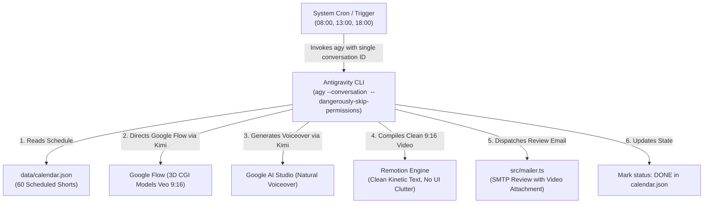

# Autonomous YouTube Shorts Production Engine (`yt-automation-wf`)

## 1. Mission & Operational Architecture
This project runs an autonomous production engine powered by **Antigravity CLI (`agy`)**. It schedules, generates, edits, reviews, and dispatches high-retention 9:16 vertical YouTube Shorts (15–30 seconds) based on a structured content calendar (`data/calendar.json`).

All autonomous executions reuse a single persistent conversation context (`--conversation fcdb013c-7946-4c00-8518-a92ebcf45cdd`) so the agent preserves complete memory, feedback, and execution history.



---

## 2. Creative & Directorial Standards

### 🚫 Strict 3D Model Policy (Zero Real Humans)
- **Never depict or prompt real humans, live-action footage, or photos of real people.**
- **All subjects must be stylized 3D models:** 3D anatomical models, digital mannequins, Blender/Octane CGI characters, mechanical 3D cross-sections.
- Prompts must always include: `stylized 3D CGI model, digital mannequin, Octane 3D anatomical render` and negative prompt `real human, photo, live-action`.

### 🚫 Zero UI Clutter in Remotion
- **No progress bars** or top timers.
- **No act/clip indicators** ("Act 1 / 3").
- **No narration label headers** ("🎙️ NARRATION").
- **No dark background boxes/containers behind captions.**
- Captions must float directly over the 3D video as raw, bold kinetic typography (`#FFE600` active word highlights, `#FFFFFF` text with solid black drop shadow/stroke).

### 🎙️ Audio Voiceover (Google AI Studio via Kimi WebBridge)
- Automated voiceover generated via Google AI Studio (`aistudio.google.com`) using natural voices.
- Driven autonomously through the local Kimi WebBridge extension daemon (`127.0.0.1:10086`).
- Audio files saved to `public/audio/[serialId].mp3` and mixed directly in Remotion.

---

## 3. Autonomous Antigravity CLI Execution

### Headless Production Command
```bash
agy --conversation fcdb013c-7946-4c00-8518-a92ebcf45cdd \
  -p "Produce the scheduled YouTube Short for the current time slot. Generate 3D model clips via Google Flow, voiceover via Google AI Studio, assemble clean kinetic video in Remotion, dispatch review email, and mark as DONE." \
  --dangerously-skip-permissions
```

### Scheduled Cron Automation (08:00, 13:00, 18:00)
Add to crontab (`crontab -e`):
```bash
0 8,13,18 * * * cd /home/oluomachi-c-udezue/projects/yt-automation-wf && /home/oluomachi-c-udezue/.local/bin/agy --conversation fcdb013c-7946-4c00-8518-a92ebcf45cdd -p "Execute scheduled YouTube Short production for current time slot." --dangerously-skip-permissions >> /home/oluomachi-c-udezue/projects/yt-automation-wf/cron.log 2>&1
```

---

## 4. Quality Gates & Validation
- **Typecheck:** `npm run typecheck` (`tsc --noEmit`)
- **Unit Tests:** `npm test` (`vitest run`)
- **Calendar Update:** `npm run update-calendar`
