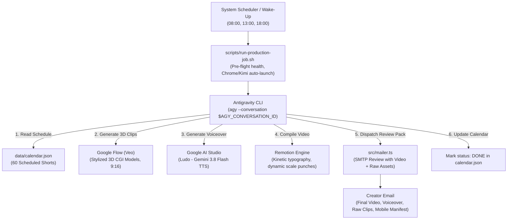

# 🎬 Autonomous YouTube Shorts Production Engine

> **A fully autonomous, self-healing pipeline powered by [Antigravity CLI (`agy`)](https://github.com/google/antigravity), [Google Flow](https://flow.google.com), [Google AI Studio](https://aistudio.google.com), and [Remotion](https://www.remotion.dev). It schedules, generates, edits, reviews, and dispatches high-retention 9:16 vertical YouTube Shorts on a daily calendar.**

---

## 📌 Table of Contents
- [Architecture & Workflow](#-architecture--workflow)
- [Creative & Directorial Standards](#-creative--directorial-standards)
- [Prerequisites & System Requirements](#-prerequisites--system-requirements)
- [Quick Start Guide](#-quick-start-guide)
- [Configuration (.env)](#-configuration-env)
- [Autonomous Antigravity Execution](#-autonomous-antigravity-execution)
- [Scheduling & Resilient Automation (Systemd & Cron)](#-scheduling--resilient-automation)
- [Remote Mission Control Dashboard](#-remote-mission-control-dashboard)
- [Calendar Import & Export](#-calendar-import--export)
- [Git Hygiene & Security](#-git-hygiene--security)
- [Quality Assurance & Testing](#-quality-assurance--testing)

---

## 🚀 Architecture & Workflow

The engine runs 3 times daily (**08:00 Morning**, **13:00 Afternoon**, **18:00 Evening**) or on demand. It uses a **single persistent conversation context** with Antigravity CLI so the AI agent maintains unbroken memory of directorial guidelines, previous renders, and user feedback.



---

## 🎨 Creative & Directorial Standards

### 🚫 Strict 3D Model Policy (Zero Real Humans)
- **Never depict or prompt real humans, live-action footage, or photographic faces.**
- **All subjects must be stylized 3D models:** Anatomical digital mannequins, Blender/Octane 3D characters, or mechanical cross-sections.
- **Negative Prompt for Every Clip:** `real human, photo of real person, live-action footage, realistic skin pores, photorealistic human face`.
- **Positive Style Tokens:** `stylized 3D CGI model, digital mannequin, Octane 3D anatomical render, clean clay-and-metal shader, Blender 3D render, mechanical cross-section`.

### 🎙️ Audio Voiceover (Google AI Studio via Kimi WebBridge)
- **Voice Preset:** **`Ludo`** (Gemini 3.8 Flash TTS in Google AI Studio).
- **Tone Profile:** Confident, articulate, curiosity-driven low-pitch male voice modeled on the fast-paced explainer cadence of *Zack D. Films* without copyright or impersonation flags.
- **Transcoding:** Audio is normalized and boosted to -1.5 dB peak via FFmpeg (`-ar 48000 -ac 2 -b:a 192k`).

### ⚡ Pacing & Cut Dynamics
- **Total Duration:** 15–20 seconds total (~5.0s to 5.5s per act). Never pad videos with dead air or lingering silent footage.
- **Dynamic Scale Punch on Cut:** Each clip entrance performs an energetic camera scale punch (`scale(1.06) -> scale(1.0)` over 9 frames) to maintain maximum retention.
- **Seamless Edge Dissolve:** 4-frame crossfade at clip boundaries eliminates jarring cut jumps.
- **Kinetic Word Highlighting:** Subtitles highlight word-by-word at a ~0.33s cadence, locking in 1:1 with voiceover enunciation.

### 🚫 Zero UI Clutter in Remotion
- **No progress bars** or top timers.
- **No act/clip indicators** ("Act 1 / 3").
- **No narration label headers** ("🎙️ NARRATION").
- **No dark background boxes/containers behind captions.**
- Captions float directly over the 3D video as raw, bold kinetic typography (`#FFE600` active word highlights, `#FFFFFF` text with solid black drop shadow/stroke).

### 📦 Complete Production Package Dispatch
Every review email automatically attaches the entire asset suite so the creator can review or edit independently on mobile (CapCut, VN, Premiere Rush) away from their computer:
1. `[serialId]_Final_Render.mp4`: Complete compiled short with kinetic captions and voiceover.
2. `[serialId]_Voiceover.mp3`: Clean voiceover track (Ludo, Google AI Studio TTS).
3. `[serialId]_Raw_Clip_01.mp4`, `02.mp4`, etc.: Individual 3D CGI clips (Google Flow).
4. `[serialId]_Edit_Manifest.txt`: Plain text document containing act-by-act narration lines, visual prompts, SFX cues, and mobile editing tips.

---

## 🛠️ Prerequisites & System Requirements

- **Linux OS** (Ubuntu 22.04+ recommended; tested on Wayland/X11)
- **Node.js** (v20+ or v24+) & **npm**
- **Google Chrome** (v120+ with remote debugging enabled)
- **FFmpeg** (for video rendering & audio transcoding)
  ```bash
  sudo apt-get install -y ffmpeg
  ```
- **[Antigravity CLI (`agy`)](https://github.com/google/antigravity)**:
  ```bash
  curl -fsSL https://antigravity.google/install.sh | bash
  # Verify installation:
  agy --version
  ```
- **[Kimi WebBridge](https://github.com/kimi/webbridge)**: Browser automation daemon for navigating Google Flow and Google AI Studio with existing sessions.
  ```bash
  kimi-webbridge run --addr 127.0.0.1:10086
  ```

---

## ⚡ Quick Start Guide

1. **Clone the repository:**
   ```bash
   git clone https://github.com/your-username/yt-automation-wf.git
   cd yt-automation-wf
   ```

2. **Install dependencies:**
   ```bash
   npm install
   ```

3. **Configure environment:**
   ```bash
   cp .env.example .env
   # Edit .env with your SMTP credentials and AGY conversation ID
   nano .env
   ```

4. **Verify test suite:**
   ```bash
   npm run typecheck
   npm test
   ```

5. **Start Remote Mission Control Dashboard:**
   ```bash
   npm run dashboard
   # Opens on http://localhost:4100 (or your LAN IP http://<local-ip>:4100 on your phone)
   ```

---

## 🔐 Configuration (.env)

Copy `.env.example` to `.env` and fill in your values:

```ini
# SMTP Review Notification Configuration
SMTP_HOST=mail.privateemail.com
SMTP_PORT=465
SMTP_SECURE=true
SMTP_USER=hello@yourdomain.com
SMTP_PASS=your-smtp-password

# Recipient Email (where review packages are delivered)
NOTIFICATION_EMAIL=creator@example.com

# Remote Dashboard Port (default: 4100)
DASHBOARD_PORT=4100

# Antigravity CLI (agy) Persistent Conversation Context
# Reusing a persistent conversation ID preserves agent memory, feedback, and skills across cron runs
AGY_CONVERSATION_ID=fcdb013c-7946-4c00-8518-a92ebcf45cdd
AGY_BIN_PATH=/home/youruser/.local/bin/agy
```

> [!IMPORTANT]
> The `.env` file is strictly excluded in `.gitignore`. Never commit credentials or personal conversation IDs to version control.

---

## 🤖 Autonomous Antigravity Execution

### 1. Manual One-Off Production
To produce the next pending video or force-produce Short #1:
```bash
npx tsx src/workflow.ts --force
```

### 2. Autonomous Headless Production via Antigravity CLI
Invoke Antigravity CLI headlessly with your persistent conversation context:
```bash
agy --conversation $(grep AGY_CONVERSATION_ID .env | cut -d '=' -f2) \
  -p "Produce the scheduled YouTube Short for the current time slot. Generate 3D model clips via Google Flow, voiceover via Google AI Studio, assemble clean kinetic video in Remotion, dispatch review email, and mark as DONE." \
  --dangerously-skip-permissions
```

---

## ⏰ Scheduling & Resilient Automation

A basic cron job fails if your computer is asleep or Chrome is closed. This project includes a **Self-Healing Runner Script** ([`scripts/run-production-job.sh`](file:///home/oluomachi-c-udezue/projects/yt-automation-wf/scripts/run-production-job.sh)) with built-in resilience:

- **Wake-up Catch-up (`Persistent=true`)**: If your PC was asleep at 08:00 and you open it at 08:45, it immediately detects the missed slot and produces the morning Short.
- **Auto-Launch Prerequisites**: If Chrome or Kimi WebBridge was closed, the script automatically launches them before triggering the pipeline.
- **Wi-Fi Reconnect Grace**: Waits up to 60 seconds with backoff for network reconnection upon waking.
- **Exponential Retry Loop**: Retries up to 3 times (with 3-minute backoff) if temporary rate limits or network glitches occur.

### 🌍 Cross-Platform Execution Options

The production pipeline is 100% cross-platform and runs identically on **Linux**, **macOS**, and **Windows**:

| Platform | Command / Script | Scheduler |
| :--- | :--- | :--- |
| **Universal (All OS)** | `npm run job` (`npx tsx src/runner.ts`) | Works anywhere Node is installed |
| **Linux** | `scripts/run-production-job.sh` | `systemd --user` timer or `cron` |
| **Windows** | `scripts/run-production-job.ps1` | **Windows Task Scheduler** |
| **macOS** | `scripts/run-production-job.sh` or `npm run job` | `launchd` or `cron` |

---

### Setting Up Systemd User Timer (Linux Recommended)

1. Create service `~/.config/systemd/user/yt-shorts-producer.service`:
   ```ini
   [Unit]
   Description=YouTube Shorts Autonomous Production Engine
   After=network-online.target
   Wants=network-online.target

   [Service]
   Type=oneshot
   WorkingDirectory=/path/to/yt-automation-wf
   ExecStart=/path/to/yt-automation-wf/scripts/run-production-job.sh
   StandardOutput=append:/path/to/yt-automation-wf/cron.log
   StandardError=append:/path/to/yt-automation-wf/cron.log
   ```

2. Create timer `~/.config/systemd/user/yt-shorts-producer.timer`:
   ```ini
   [Unit]
   Description=Timer for YouTube Shorts Autonomous Production Engine

   [Timer]
   OnCalendar=*-*-* 08,13,18:00:00
   OnCalendar=*:00,30
   Persistent=true
   Unit=yt-shorts-producer.service

   [Install]
   WantedBy=timers.target
   ```

3. Enable and activate:
   ```bash
   systemctl --user daemon-reload
   systemctl --user enable --now yt-shorts-producer.timer
   ```

### Crontab Fallback (Linux & macOS)
Add to `crontab -e`:
```bash
0 8,13,18 * * * /path/to/yt-automation-wf/scripts/run-production-job.sh >> /path/to/yt-automation-wf/cron.log 2>&1
```

### Windows Task Scheduler Setup
On Windows, schedule `scripts\run-production-job.ps1` via PowerShell or Task Scheduler:
```powershell
# Create task running at 08:00, 13:00, 18:00
$Action = New-ScheduledTaskAction -Execute "powershell.exe" -Argument "-ExecutionPolicy Bypass -File C:\path\to\yt-automation-wf\scripts\run-production-job.ps1"
$Trigger = New-ScheduledTaskTrigger -Daily -At "08:00"
Register-ScheduledTask -TaskName "YTShortsProducer" -Action $Action -Trigger $Trigger
```

---

## 📱 Remote Mission Control Dashboard

Run the dashboard locally or as a permanent background service:
```bash
npm run dashboard
```

- **Local Access**: [`http://localhost:4100`](http://localhost:4100)
- **Phone / Mobile Access (Same Wi-Fi)**: `http://<your-lan-ip>:4100`

### Dashboard Capabilities:
- **Status Filtering**: Filter by `All`, `Pending`, `Done`, or `Failed`.
- **Search**: Search 60+ topics instantly by keyword.
- **Inline Editing**: Tweak topics, script lines, and SFX cues from your phone.
- **One-Tap "Produce"**: Trigger instant autonomous generation of any specific short on demand.
- **In-Browser Video Player**: Preview vertical 9:16 renders directly inside your browser.

---

## 📥 Calendar Import & Export

The dashboard includes full data portability:

- **⬇️ Export Calendar**:
  - **JSON**: Full structured calendar with act cues and timing (`/api/calendar/export?format=json`).
  - **CSV**: Compatible with **Google Sheets**, Excel, and Apple Numbers (`/api/calendar/export?format=csv`).
- **⬆️ Import & Append**:
  - Upload a `.json` calendar file or paste raw JSON text.
  - **Auto-Formatting**: Automatically assigns sequential IDs (`VID-061`, `VID-062`), schedules slots in order, and generates default 3-act CGI scene cues for simple topic lists.

---

## 🔒 Git Hygiene & Security

- **Strict Media Hygiene**: Raw and compiled media (`.mp4`, `.mp3`, `.wav`, `.mov`) are strictly excluded in `.gitignore` and **must never be committed to Git**.
- **Secret Isolation**: All credentials, tokens, and conversation IDs are loaded strictly from `.env`.

---

## 🧪 Quality Assurance & Testing

Run all automated quality gates before committing:

```bash
# Typecheck TypeScript codebase
npm run typecheck

# Run Vitest test suite (calendar validation, mailer packaging, import/export)
npm test
```

---

## 📄 License
MIT License. Created for autonomous vertical video production with Google Antigravity.
