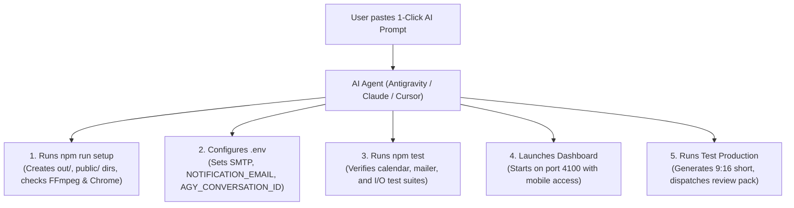

# 🤖 AI Agent & Developer Replication Playbook

> **If you cloned this repository and want your AI agent (Google Antigravity, Claude Code, Cursor, Windsurf, Copilot, Gemini CLI) to set up and run the entire YouTube Shorts production pipeline automatically, simply give it the prompt below.**

---

## 📋 The 1-Click AI Agent Prompt

Copy and paste this exact prompt into your AI coding agent:

```text
I have cloned the YouTube Shorts Automation Engine repository. Please act as my Autonomous Pipeline Engineer:
1. Inspect `SETUP.md`, `README.md`, and `GEMINI.md` to understand the architecture, directorial standards, and pipeline flow.
2. Run `npm install` and `npm run setup` to diagnose prerequisites and prepare directory structures.
3. Help me configure `.env` based on `.env.example` (prompt me for my SMTP credentials, recipient email, and persistent Antigravity conversation ID).
4. Run `npm run typecheck` and `npm test` to verify that all quality gates pass.
5. Start the Remote Mission Control Dashboard (`npm run dashboard`) in the background.
6. Trigger a test render using `npm run workflow -- --force` and confirm the compiled video and full review pack.
```

---

## 🏗️ What the AI Agent Will Do

When an AI assistant receives the prompt above, here is the automated execution roadmap it follows:



---

## ⚙️ Step-by-Step Manual Guide (For Humans)

If you are setting up the project manually without an agent:

### Step 1: Install Dependencies & Run Automated Setup
```bash
npm install
npm run setup
```
The automated setup script:
- Verifies and creates necessary media directories (`out/`, `public/clips/`, `public/audio/`, `public/dashboard/`).
- Copies `.env.example` to `.env` if not present.
- Checks system binaries (`ffmpeg`, `google-chrome`, `agy`).
- Runs the test suite to ensure the environment is healthy.

---

### Step 2: Configure Environment Variables
Open `.env` and fill in your details:
```ini
# SMTP Settings (PrivateEmail, Gmail, SendGrid, etc.)
SMTP_HOST=mail.privateemail.com
SMTP_PORT=465
SMTP_SECURE=true
SMTP_USER=no-reply@yourdomain.com
SMTP_PASS=your-smtp-password

# Email where review packages are delivered
NOTIFICATION_EMAIL=creator@example.com

# Antigravity CLI Persistent Session Context
# (Obtained by running `agy` once or using an existing conversation UUID)
AGY_CONVERSATION_ID=your-persistent-conversation-id
AGY_BIN_PATH=/home/youruser/.local/bin/agy
```

---

### Step 3: Start Remote Management Dashboard
```bash
npm run dashboard
```
Open **`http://localhost:4100`** on your computer, or **`http://<your-lan-ip>:4100`** on your phone (connected to the same Wi-Fi network).

From the dashboard, you can:
- View all 60 scheduled YouTube Shorts.
- Edit topics, narration lines, and time slots.
- Export to **JSON** or **CSV** (for Google Sheets).
- Import / append new video topics with automatic scheduling.
- Preview rendered 9:16 vertical videos in-browser.
- Tap **▶️ Produce** to generate any Short on demand.

---

### Step 4: Run a Test Production Job
```bash
npm run workflow -- --force
```
This compiles the next due Short, renders the clean kinetic subtitles via Remotion, and dispatches the complete production asset suite to your email.

---

## 🎨 Directorial Rules Enforced by the Engine

Any AI producing content with this engine must adhere to the rules in [`GEMINI.md`](./GEMINI.md):

1. **Strict 3D Model Policy (Zero Real Humans)**: Never depict real people. Only stylized 3D CGI models, digital mannequins, and Octane/Blender anatomical models.
2. **Standard Voiceover**: Google AI Studio Gemini 3.8 Flash TTS with the **`Ludo`** voice model (*Zack D. Films* explainer cadence).
3. **Pacing**: 15–20s tight runtime (~5.0s to 5.5s per act). Never pad with dead air.
4. **Clean Kinetic Typography**: Raw text floating directly over 3D visuals (`#FFE600` active word highlights, `#FFFFFF` text, black drop shadow). No containers, no progress bars, no UI clutter.
5. **Complete Production Package**: Review emails must contain the final video, raw 3D clips, voiceover audio, and an act-by-act mobile editing manifest for CapCut/VN.

---

## 🧪 Validation & Health Checks
```bash
npm run typecheck    # TypeScript compiler check
npm test             # Vitest test suite (9 tests)
npm run job          # Test scheduled production runner
```
